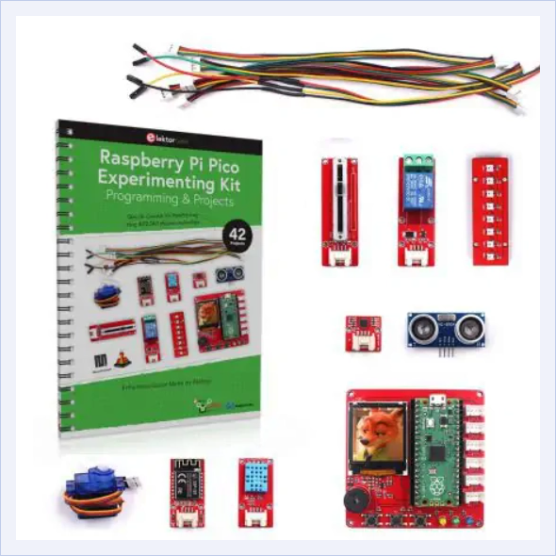
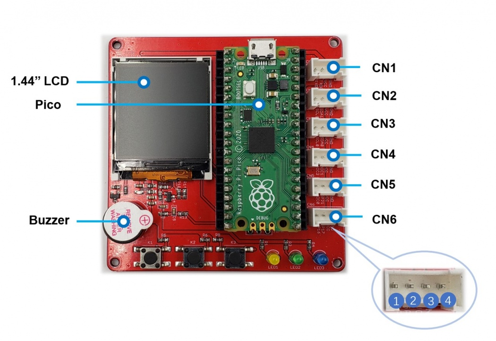

<picture>
    
</picture>

# Elektor Pico Primer Kit

This bundle was originally sold (in 2021-2025) by [Elektor](https://www.elektor.com) and made by [Makerfabs](https://www.makerfabs.com) with MicroPython example codes.

*Credit : Elektor*

This kit consist of a main board with a TFT LCD screen (1.44" ST7735 driver) for the Raspberry Pi Pico with the following accessories :

* 3 push buttons, 3 LEDs, 1 buzzer, 6 connectors (on the board)
* 1 slide potentiometer
* 1 magnetic relay (10A)
* 1 strip of 8 LEDs (WS2818)
* 1 Inertial Measure Unit (IMU) MPU6050 with 6 axes (accelerometer, gyroscope)
* 1 ultrasonic distance sensor (HC-SR04)
* 1 servomotor (SG90)
* 1 serial to WIFI (ESP module)
* 1 humidity and temperature sensor (DHT11)

This repository is an attempt to port MicroPython codes to the CircuitPython environment for educational projects.

## Printed Circuit Board (PCB) :

List of the connectors, pins, Pico GPIOs on the main board :

*Credit : Makerfabs*

| Connectors | Pin 1 | Pin 2 | Pin 3 | Pin 4 |
|:----------:|:-----:|:-----:|:-----:|:-----:|
| `CN1`      | GP1   | GP0   | VCC   | GND   |
| `CN2`      | GP7   | GP6   | VCC   | GND   |
| `CN3`      | GP9   | GP8   | VCC   | GND   |
| `CN4`      | GP28  | GP27  | VCC   | GND   |
| `CN5`      | GP26  | GP21  | VCC   | GND   |
| `CN6`      | GP16  | GP17  | VCC   | GND   |

| Buttons | GPIO | LEDs    | GPIO |  Buzzer  | GPIO |
|:-------:|:----:|:-------:|:----:|:--------:|:----:|
| `K1`    | GP2  | `LED1`  | GP18 | `BUZZER` | GP4  |
| `K2`    | GP3  | `LED2`  | GP19 |||
| `K3`    | GP22 | `LED3`  | GP20 |||

## Code :

Look at the [code](code/) folder to use example codes. **Work In Progress !**

## TODO :

- [x] [tft] Add code for checking the TFT LCD screen
- [ ] [tft][board] Add code for the push buttons, buzzer
- [ ] [tft][ptr] Add code for he slide potentiometer
- [ ] [tft][relay] Add code for the magnetic relay
- [ ] [tft][leds] Add code for the strip LEDs
- [ ] [tft][imu] Add code for the IMU
- [ ] [tft][dist] Add code for the distance sensor
- [ ] [tft][servo] Add code for the servomotor
- [ ] [tft][wifi] Add code for the WIFI
- [ ] [tft][dht11] Add code for the temperature sensor

## Documentation :

Raspberry Pi Pico series :
* https://www.raspberrypi.com/documentation/microcontrollers/pico-series.html

Makerfabs :
* Shop : https://www.makerfabs.com/raspberry-pi-pico-primer-kit.html
* Common Wiki : https://wiki.makerfabs.com/Pico_W_Primer_Kit.html (Pico, Pico W)
* GitHub : https://github.com/Makerfabs/Pico_Primer_Kit

Useful software :
* Thonny IDE : https://thonny.org :ok_hand:

> [!NOTE]
> Big thanks to these different companies [Adafruit](https://www.adafruit.com), [Makerfabs](https://www.makerfabs.com), to all [Python](https://www.python.org/), [MicroPython](https://micropython.org), [CircuitPython](https://circuitpython.org) communities. :heart:

Happy coding & have fun ! :partying_face: